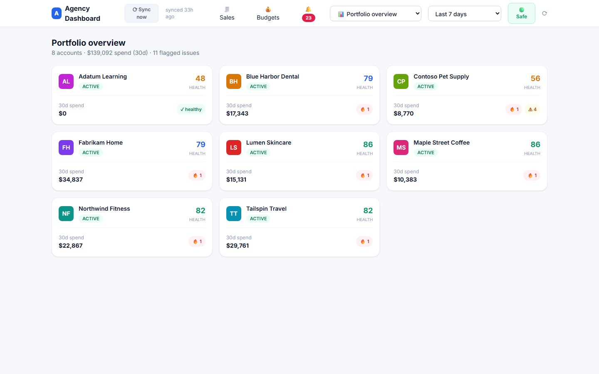
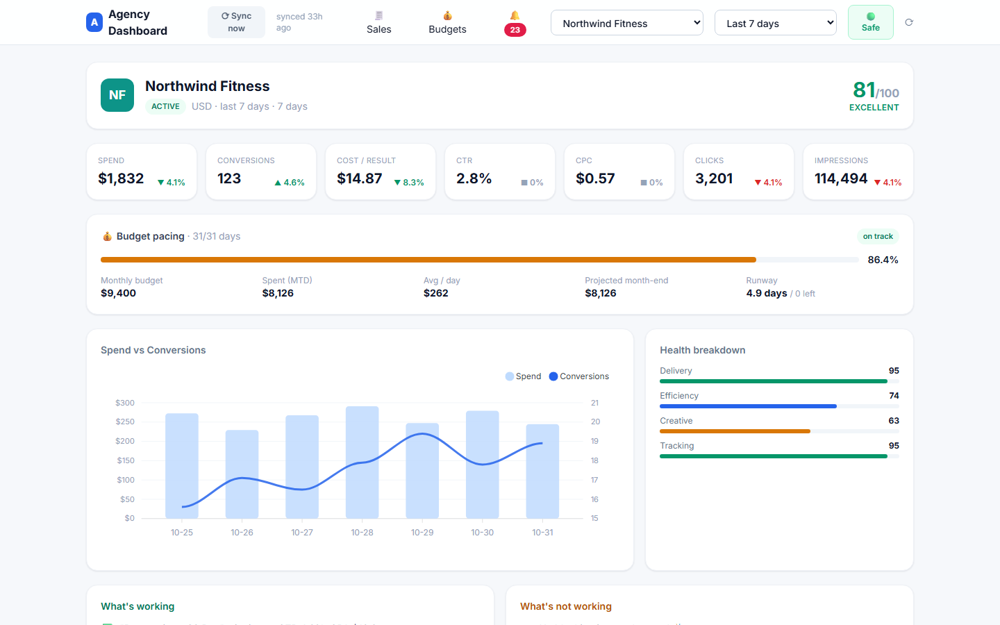

# meta-ads-dashboard

An agency view across every Meta ad account: spend, health, pacing and alerts on one page, so nothing sits broken inside an account nobody opened today.



*Portfolio overview*



*Account view*

## Why it exists

Ads Manager shows one account at a time. With many clients, a stalled campaign or missing tracking can go unnoticed for days.

## How it works

- Syncs account, campaign, creative and geo data daily
- Scores each account on delivery, efficiency, creative and tracking
- Tracks budget pacing and creative fatigue
- Raises alerts, with optional Slack delivery
- Pause, resume and budget changes run through a safe mode with an action log and undo

## Run it

```bash
pip install -r requirements.txt
AGENCY_DB=demo.db python seed_mock.py
AGENCY_DB=demo.db python app.py     # http://127.0.0.1:8000
```

## Notes

Screenshots use made-up brands and made-up numbers. No client data is in this repo.

## Stack

Python, FastAPI, SQLite, Tailwind, Meta Marketing API

Built by [Vinay Kumar](https://vinaykumar.work) with Claude Code. I set the design and rules and reviewed the output.
